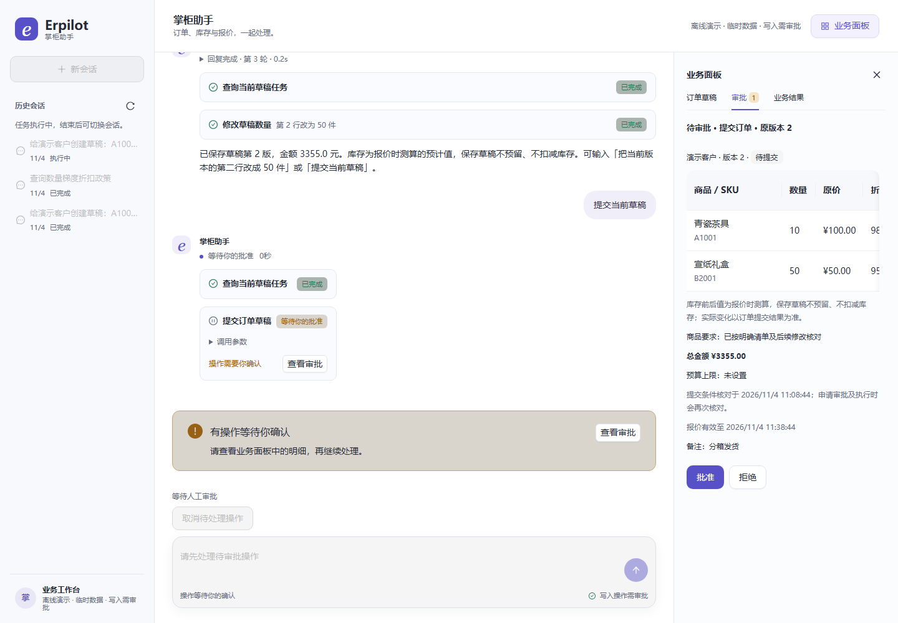
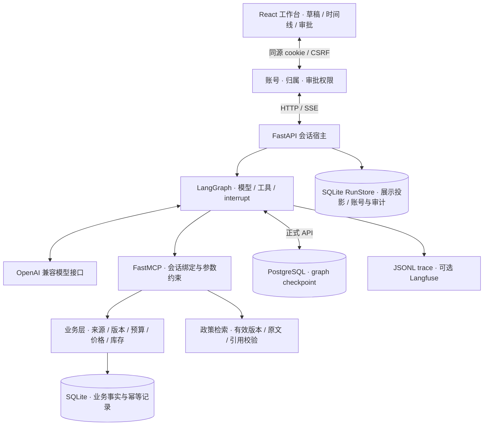

# Erpilot · 会请示的 ERP 智能体

把“给客户备一份订单”变成可核对的报价草稿，在人工批准指定版本后才真正建单、扣库存。

面向 **Agent 应用开发 / Python 后端工程**的求职作品。模型负责提出工具调用，应用负责核对来源、业务规则与审批，数据库负责记录最终事实。

[三分钟演示](docs/demo-guide.md) · [实际架构](docs/architecture.md) · [面试案例](docs/interview-cases.md) · [投递材料](docs/application-kit.md) · [当前状态与证据](docs/project-status.md)

## 解决什么问题

ERP 操作里，“模型理解了”到“业务可以执行”之间有很长一段距离：商品可能重名，用户会改数量或预算，报价会过期，审批页面会刷新，业务提交后服务也可能中断。

Erpilot 把这些问题放进一个可演示的完整流程：

1. 用户给出客户、商品、件数、备注与预算；应用查询真实商品和库存，生成带版本的草稿。
2. 多轮修改保留未变字段和来源；超出预算、商品或报价条件变化时提示待确认事项。
3. 用户核对完整版本并申请审批；批准后，事务再次复核价格、库存、版本及有效期。
4. 同次提交使用稳定幂等键；断线后恢复原审批，结果不明时先查业务提交事实。
5. 政策问题展示本轮有效证据和原文；没有依据时拒答。补货建议给出计算依据，不自动采购。



截图来自实际本地离线演示：脚本模型、正式 API / MCP 和临时业务库。

## 一条命令启动演示

准备 **Python 3.12+、[uv](https://docs.astral.sh/uv/getting-started/installation/)、Node.js 22+（含 npm）**，在仓库根目录运行：

```sh
python scripts/quickstart.py
```

入口按 `uv.lock` 和 `package-lock.json` 安装、构建前端，再启动[本地页面](http://127.0.0.1:8765)。首次安装需要网络；演示不需要 `.env`、模型密钥、Docker 或 PostgreSQL。

页面选择“创建草稿”→“修改第二行”→“提交草稿”，刷新后先拒绝，再核对版本并重新批准。也可选“商品名称下单”“政策证据”“无依据拒答”“补货建议”。[逐步讲解及预期金额](docs/demo-guide.md)。

**演示使用脚本模型、关键词演示向量及独立临时库**，经过正式 API / LangGraph / MCP / 业务事务。只支持页面提供的固定指令；它验证工程流程，真实模型表现另见独立报告。Ctrl+C 关闭，重启清空演示数据。

```sh
python scripts/quickstart.py doctor                    # 只读环境诊断
python scripts/quickstart.py demo --skip-install        # 复用依赖，重新构建
python scripts/quickstart.py demo --port 8877            # 指定端口
python scripts/quickstart.py verify                     # 离线工程验收及日志
python scripts/quickstart.py verify --browser            # 另含匹配浏览器与端到端验收
```

## 带账号和持久恢复的容器演示

安装 Docker / Compose 后，在仓库根目录运行：

```sh
docker compose up --build -d --wait
docker compose exec api python -m erpilot_api.users add demo-owner --role approver
```

交互设置密码后，打开 [http://127.0.0.1:8768](http://127.0.0.1:8768) 登录。前端/API 同源，
账号隔离自己的会话、草稿和审批；操作员只能查询与准备草稿，审批员可执行自己的任务。
默认仍为无付费请求的脚本模型，但 ERP 数据和 PostgreSQL checkpoint 持久化，可重建容器恢复审批。
没有默认应用账号；基础镜像不包含密钥。真实模型覆盖配置、备份和浏览器验收见[部署指南](docs/deployment.md)。

## 架构与执行边界



离线演示显式使用内存 checkpoint 和临时 SQLite；正式模型 API 要求 PostgreSQL，缺少时拒绝启动。`agent_core` 不依赖 ERP 或 MCP 业务包。完整数据流、失败窗口与限制见[架构说明](docs/architecture.md)。

| 技术选择 | 承担的职责与理由 |
|---|---|
| Python 3.12 / FastAPI / Pydantic | 异步工具与流式响应，入口和业务结构可验证 |
| LangGraph | 持久化执行状态和审批中断；保留自定义工具协议与业务约束 |
| FastMCP | 真实工具发现、参数 schema 和协议调用；风险与会话权限由应用绑定 |
| SQLite / SQLAlchemy | 小规模业务事实、版本和幂等同事务提交；单进程范围易复现 |
| PostgreSQL checkpoint | 保存可恢复的图状态；与业务数据库的职责分别明确 |
| 轻量 JSON 向量索引 | 小型政策语料可直接核对；有 BM25 / RRF 对照后再决定复杂度 |
| OpenAI 兼容 SDK | 用配置切换供应商；当前无 LiteLLM 路由服务 |
| React / TypeScript / Ant Design X | 流式工作台、业务卡片和响应式审批界面 |
| pytest / Playwright / 自建评测 | 分别核对业务事实、用户操作和真实模型表现；保留失败与未知用量 |

[最初选型及实施核对](docs/adr/0001-tech-stack.md) · [当前交付范围决策](docs/adr/0011-local-portfolio-delivery.md)

## 实现与取舍

- **将写权限放在模型之外**：写工具必须绑定代码审批门；模型请求只产生待批准动作。报价、保存草稿和政策查询都不等于批准订单。
- **让批准绑定不可变事实**：指定草稿版本、完整参数和稳定 token；批准后仍在业务事务内复核，库存变化时停止，不自行改版继续执行。
- **恢复先查业务事实**：graph checkpoint 保存执行状态，mutation token 证明业务是否提交，RunStore 只服务展示；三者不互相冒充权威来源。
- **约束回答的证据来源**：政策答复校验本轮引用、版本、原文及哈希，由程序渲染；仍不宣称已经解决任意自然语言的语义蕴含。
- **用可重放结果解释模型表现**：固定用例、逐轮 trace、数据库前后状态、原币种费用与缺 usage 熔断；不把不同版本的成功样例拼成一个通过率。

具体难点、源码入口、失败归因和面试追问见[三个实现案例](docs/interview-cases.md)。项目描述应按本人实际参与范围使用，见[求职投递材料](docs/application-kit.md)。

## 验证与证据

`verify` 默认执行静态检查、Python 离线测试、前端协议与渲染测试、构建及 **11 个离线业务场景**。加 `--browser` 后安装匹配 Chromium，运行工作台和真实 API 的浏览器验收。逐步日志、JUnit 和汇总留在 `artifacts/verification/`；任何步骤失败返回非零状态。

PostgreSQL 恢复测试仅在显式设置隔离的 `ERPILOT_TEST_CHECKPOINT_DATABASE_URL` 后运行；未配置时会标注跳过。真实模型用例默认排除，浏览器中另有两个需独立实验服务的语义预览用例，未配置时单列跳过。[完整检查与故障处理](docs/development.md)。

2026-11-04 最终打磨验收：Python **1861 passed / 0 skipped**（含独立 PostgreSQL）、前端 116、
工作台浏览器 60、正式离线 API 浏览器 5、容器浏览器 3、业务场景 11/11；上述两个专用实验用例跳过。
干净源码副本从锁定安装到实际建单、320/1440px 和刷新恢复通过，正常离线流程浏览器错误及告警为 0。
依赖审计无已知漏洞，已重新录制字幕演示。[打磨清单与证据](reports/acceptance/2026-11-04-finishing.md)。

| 已有真实观察 | 结果与范围 | 原始证据 |
|---|---|---|
| 政策答复 v4，GLM | 13/13 受控检索用例；旧 v3 两模型各 11/13 保留 | [独立批次](reports/acceptance/2026-10-28-contracts-and-policy.md) |
| 预算完整流程，GLM | 1/1 流程、10/10 阶段；超额停止、明确调预算、重新审批 | [预算专项](reports/acceptance/2026-10-21-budget-live-validation.md) |
| 草稿指代最终专项 | GLM / DeepSeek 各 3/3 场景、7/7 轮 | [指代验收](reports/acceptance/2026-10-19-b4-final-validation.md) |
| 只读补货建议 | GLM / DeepSeek 各 7/7，一组成对运行 | [B6 验收](reports/acceptance/2026-10-19-live-model-validation.md) |
| 冻结检索对照 | test Recall@3 96.9%；RRF 未超过当前策略，保留原默认 | [检索实验](docs/retrieval-experiment.md) |
| 11-04 订单 v2 修复后真实批次 | **4/4 流程、34/34 阶段**；55 请求/usage 齐全，估价 CNY 0.052260；旧失败保留 | [本轮验收](reports/acceptance/2026-11-04-real-model-reconnect.md)、[原始批次](reports/acceptance/20261104-reconnect-corrected-order-v2.json) |
| 11-04 语义工程专项 | 创建 **7/7**、修改 **6/6**；真实 API 默认开启受约束语义预览；120条标签已完成委托AI审核 | [真实专项与失败历史](reports/acceptance/2026-11-04-real-model-reconnect.md)、[标签审核](docs/label-review.md) |
| 带登录的真实 HTTP 建单 | 真实模型草稿 → 指定版本核对 → 审批 → 精确库存与重复批准拦截，**6 项检查通过** | [API 证据](reports/acceptance/20261104-reconnect-live-api-network.json)、[业务状态](reports/acceptance/20261104-reconnect-live-api-network-state.json) |

这些数字各自对应报告中的源码、固定样本和运行，不代表通用准确率或生产稳定率。最新工程结果见[项目状态](docs/project-status.md)，历史原始失败和费用冻结继续保留。

## 使用真实模型开发

```sh
uv sync --all-packages --frozen
# 将 .env.example 复制成 .env，配置模型 key；Windows 可用 Copy-Item
docker compose up -d postgres
uv run --package erp-store python -m erp_store seed
uv run --package erpilot-api python -m erpilot_api
# 另开终端
npm --prefix apps/web ci
npm --prefix apps/web run dev
```

访问[开发工作台](http://localhost:5173)。`.env.example` 解释模型、嵌入和 checkpoint 配置；真实模型、嵌入可能收费。默认 `ERPILOT_WRITES=0`，需要演示人工写入时显式设为 `1`；真实 API 默认 `enforce` 并接入语义创建/修改预览，候选仍需逐项核对；新端点需配置价目，缺价目时保留基础解析。[语义配置与降级](docs/semantic-parsing.md)。真实 RAG 索引需使用匹配的嵌入配置，[索引构建方法](docs/development.md)。

CLI：`uv run erpilot chat "查询商品 A1001 的库存"`。独立 MCP：`uv run --package mcp-erp python -m mcp_erp serve`。更多命令见[开发指南](docs/development.md)。

## 仓库导航

```text
apps/api/             FastAPI：会话、SSE、恢复、业务路由
apps/web/             React：流式对话、草稿、审批与证据卡
apps/cli/             终端交互与 trace 回放
packages/agent_core/  业务无关的图运行时、工具契约、审批和计量
packages/mcp_erp/     MCP 服务、桥接、会话与来源约束
packages/erp_store/   业务模型、草稿版本、事务、幂等和意图状态
packages/rag/         政策语料、检索、版本与引用校验
packages/evals/       冻结任务、真实模型评测、计量与质量门槛
scripts/              启动、离线演示和可校验交付
docs/                 架构、ADR、演示、技术文章和面试材料
reports/              分批验收及历史失败证据
```

当前支持**带本地账号的共享门店、单 API 执行进程**及容器复现。账号隔离工作会话，ERP 业务数据共享；
多租户、跨进程执行权和自动业务补偿未交付。默认核心任务已通过受控真实验收；语义工程专项通过，
语义预览已默认接入，原120条工程预期已完成委托AI审核，不据小样本宣称通用准确率。
[能力边界](docs/architecture.md) · [本轮计划](docs/plans/2026-11-04-production-readiness.md) · [文章系列](docs/articles/README.md) · [可校验交付包](docs/portfolio-overview.md)
