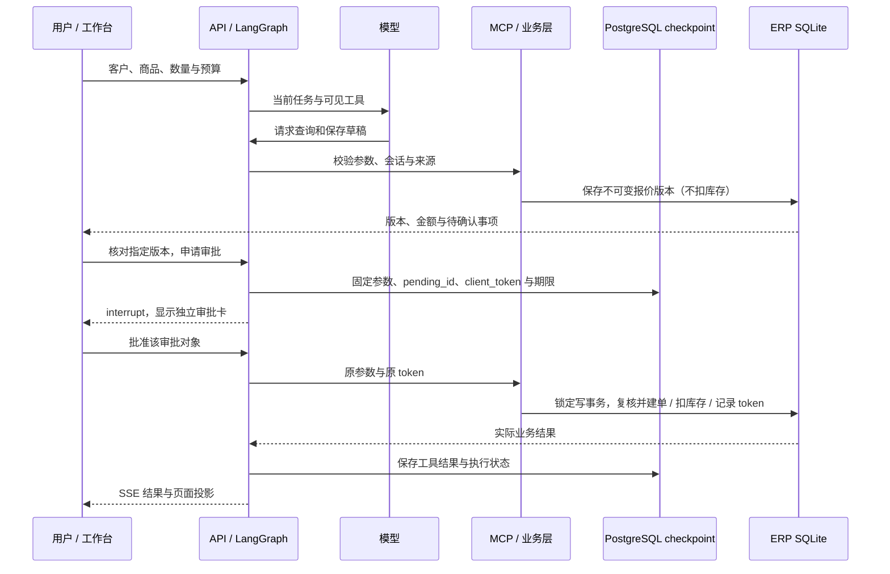

# Erpilot 实际架构与边界

更新：2026-11-04。本页描述当前源码；早期 ADR 的未来选型不作为已实现能力。

## 场景与信任边界

用户将客户、商品、件数、备注和预算交给应用。模型可以请求查询、生成草稿或提出写操作；
只有应用校验和用户批准后，订单与库存才可变化。模型输出、检索正文和备注中的文字均不能签发审批或覆盖已保存的用户要求。

| 层 | 入口 | 职责 |
|---|---|---|
| 工作台 | `apps/web/src/App.tsx` | SSE 展示、会话恢复、草稿版本核对和独立人工审批 |
| 身份与权限 | `apps/api/src/erpilot_api/auth.py`、`auth_store.py` | 账号、服务端登录、CSRF、资源归属、角色与操作审计；容器模式强制启用 |
| API 宿主 | `apps/api/src/erpilot_api/main.py`、`service.py` | 会话级串行执行、运行 / 审批 / 恢复路由、持久化展示事件 |
| 业务无关运行时 | `packages/agent_core/src/agent_core/graph.py` | 模型、参数校验、并行只读工具、审批写入、对账、结果收集 |
| 工具适配 | `packages/mcp_erp/src/mcp_erp/session_tools.py`、`bridge.py` | MCP 发现与调用、可信会话绑定、风险和来源约束；绑定恢复查询 |
| 业务事实 | `packages/erp_store/src/erp_store/` | 价格、预算、草稿不可变版本、库存、订单、幂等事务 |
| 政策证据 | `packages/rag/src/rag/`、`mcp_erp/policy_answer.py` | 语料、有效期筛选、检索、引用 / 原文校验和可信渲染 |
| 评测 | `packages/evals/src/evals/` | 固定任务、状态断言、模型用量、预算、报告和独立质量门槛 |

依赖方向：`agent_core` 不导入 `erp_store` 或 `mcp_erp`，具体工具和对账适配由宿主注入。
ERP 规则集中于业务层；前端禁用按钮用于交互，不能替代服务端与事务检查。

## 一次订单执行

用户也可通过表单准备草稿，并在完整核对后直接申请版本审批，这一路径不需要模型解释确认文字。
语义候选只能产生待核对预览，不能跳过表单确认、报价或审批。

## 三类状态各自证明什么

| 状态 | 存储 | 权威范围 | 不承担的职责 |
|---|---|---|---|
| graph checkpoint | 正式 API 为 PostgreSQL | 消息、节点、待审批参数、原 token 与运行状态 | 不证明 ERP 事务已提交 |
| 业务记录及 mutation token | SQLite | 订单、库存、不可变草稿版本、某个 token 的提交事实 | 不代替用户审批和图节点状态 |
| RunStore / 展示事件 | SQLite | 历史列表、时间线、SSE 事件投影与游标 | 不驱动未完成写入重放 |

两类数据库没有跨库原子事务。业务提交与幂等结果同一 SQLite 事务落盘，写锁在读取库存之前取得。
恢复时按原 token 和参数查询：已提交就回填原结果；明确未提交且原批准有效才尝试原调用；
无法确认、参数冲突或工具版本不兼容就停止写入并提示待核对。不能换 token 绕过不确定结果。

页面断线与用户取消分别处理；取消只阻止后续动作，不承诺回滚已经提交的业务。正式进程恢复需
PostgreSQL；临时无密钥演示使用 `InMemorySaver`，只支持进程内刷新恢复，重启清空。
容器无密钥模式使用同一脚本客户端，但改用持久 ERP、RunStore、账号与 PostgreSQL，支持容器重建恢复。
[恢复设计与历史故障矩阵](adr/0010-crash-recovery-reconciliation-scope.md)仍保留原评审状态。

## 工具、上下文与政策

工具 schema 来自 MCP，Pydantic 校验规范化参数；风险、会话和来源由应用注册表绑定。
只读调用可并行，写入由图节点顺序处理并等待审批。工具参数错误、业务拒绝、结果未知和成功分别记录。

订单修改查询持久化草稿，以具体版本与 SKU 定位行；旧聊天文本不充当最新报价。
已有来源、预算和备注随版本保存。价格或库存变化要求重新核对，不能自动替用户放宽预算。
可选上下文投影保留受保护消息，超过估算预算时在模型请求前停止；本地估算与供应商 usage 分列。

政策语料使用轻量 JSON 索引和余弦检索，小规模片段可直接核对；已有 BM25 / RRF 对照后保留当前默认。
工具筛选有效政策，答复契约只接受本轮检索证据，复核原文、版本和哈希后由程序渲染。
无命中、过期或冲突时走明确的受阻结果。原文忠实不等于任意问题的语义充分性，这一边界通过独立真实用例验证。

## 选型及运行模式

| 模式 | 模型 / 嵌入 | 数据及 checkpoint | 用途 |
|---|---|---|---|
| 无密钥演示 | 内存 MockTransport 脚本模型、关键词向量 | 临时 SQLite、内存 checkpoint | 展示固定业务流程与卡片 |
| 带账号容器演示 | 同一脚本模型和关键词向量；前端/API 同源 | 持久 SQLite、账号与 PostgreSQL checkpoint | 登录隔离、只读角色、重建后原审批恢复 |
| 默认真实 API | OpenAI 兼容 SDK、独立嵌入配置 | 本地 SQLite、必需 PostgreSQL checkpoint | 自由输入与真实模型观察 |
| 默认语义预览（真实 API） | 规则优先、单次严格候选、独立原币种预算 | 版本化待完成请求、完整预览确认 | 默认开启；无价目/失败/额度用尽退回基础路径 |

真实 API 没有 LiteLLM 服务、pgvector、DeepEval 或完整 OpenTelemetry 管道。
本地 JSONL 为默认 trace；Langfuse 是可选 sink。当前职责不需要再叠加网关或向量数据库。

## 验证与限制

工程测试使用临时业务库、脚本 / mock 模型、HTTP 和实际 MCP；浏览器分别验证工作台替身 API 与正式离线 API。
PostgreSQL 故障专项显式使用隔离连接，每个场景创建独立 schema，并在子进程硬退出后核对实际业务。
真实模型用例、固定工程预期和人工审核标签分别保留，不以离线脚本成功冒充模型理解能力。

2026-11-04 已完成真实订单 v2 四流程 / 34 阶段及默认上下文的带账号 HTTP 建单。
可恢复验收按物理请求留账，只在完整模型响应后放行工具事件；连接异常可有限重连，业务/评分失败不随机重抽。
上下文投影区分本轮与历史观测，历史 `refresh_required` 表示需重新查询，不等于刷新报价。
语义候选备注必须来自显式完整字段，动作来源结构强校验；工程专项不替代人工金标准确率。
真实 API 统一启动并默认接入，候选预算与普通聊天隔离；仅解析工具覆盖候选截止时间。
[启用依据与边界](adr/0013-default-semantic-proposals.md)。
[本轮源码范围、真实失败、费用及结果](../reports/acceptance/2026-11-04-real-model-reconnect.md)。

本作品的容器模式使用本地账号，服务端签发会话并检查每个会话、草稿、审批和运行事件的 owner。
operator 无风险写工具且不能调用审批接口；approver 只能批准自己的任务。共享门店 ERP 数据不按租户隔离。
账号和登录与 RunStore 共库，审计记录操作者和请求，不以 HTTP 200 证明业务执行成功。
临时本机演示保留匿名路径，默认只绑定回环；旧匿名会话不认领为账号会话。

仍限制单 API 执行进程，部署多 worker 前需要独立执行权协议。租户权限、自动补偿、集群高可用及生产级运维没有交付。
语义预览默认开启；原120条标签已按用户委托完成AI审核，审核主体和边界见[标签审核](label-review.md)。
历史不完整验收仍保留原判定，不据规则回归声称通用模型准确率。

继续阅读：[容器与账号](deployment.md) · [ADR-0012](adr/0012-authenticated-container-deployment.md) · [开发与复现](development.md) · [三个面试案例](interview-cases.md) · [状态与证据](project-status.md)。
