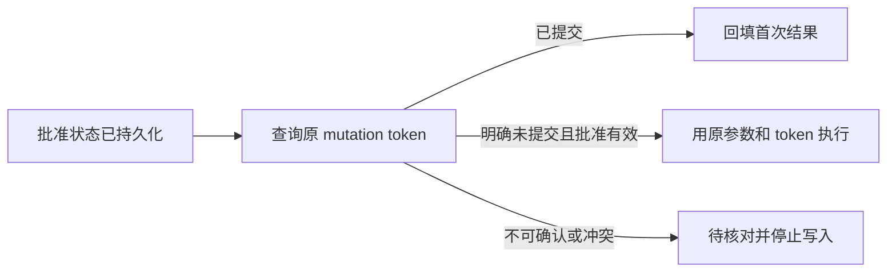

# 三个实现案例与讲解提纲

每个案例从具体业务问题进入，再解释实现、证据与取舍。数字取自链接报告，历史证据不冒充本次重新运行。

## 案例一：用户批准的究竟是哪份订单

**开场**：用户先创建两行报价草稿，再说“把第二行改成 50 件”。审批必须指向修改后的具体版本；用户拒绝后不能建单，重复提交也不能生成两张订单。

**实现**：草稿版本不可变，保存不扣库存。提交绑定 `draft_id` 与 `revision`；业务事务内重新校验价格、库存、在售状态、过期时间与版本。写工具通过 LangGraph interrupt 等待人工决定。稳定 `client_token` 将同一次批准与业务提交绑定，同键同参数返回首次结果，同键异参报冲突。

**现场展示**：演示客户 A1001 × 10、B2001 × 20，改第二行为 50，版本 2 金额 ¥3355。刷新待审批页面后拒绝，确认未执行；再次提交并批准，创建一张待付款订单。数据来自[演示指南与逐项断言](demo-guide.md)，脚本模型不作为真实模型成功率。

**实现入口**：[草稿事务](../packages/erp_store/src/erp_store/drafts.py)、[幂等写入](../packages/erp_store/src/erp_store/mutations.py)、[图审批执行](../packages/agent_core/src/agent_core/graph.py)。[订单草稿验收](../reports/acceptance/2026-10-11-order-draft.md)覆盖版本失效与重复提交；[B4 最终指代专项](../reports/acceptance/2026-10-19-b4-final-validation.md)两模型各 3/3 场景、7/7 轮，仅说明这一组成对运行通过。

**追问与取舍**：报价库存是预计值，保存不预留；执行时条件变化会停止并要求重新确认。审批不能只存在前端按钮里，因为刷新、断线和重复请求都可能发生。幂等防止重复业务提交，不替代人工审批，也不表示所有系统间操作都有全局事务。

## 案例二：库存已经改了，服务却没保存结果

**开场**：最需要分辨的窗口是 ERP 事务已经提交、graph 结果尚未 checkpoint。此时重新跑 handler 之前，必须先查原 token 的业务提交事实。

**实现**：PostgreSQL graph checkpoint 保存执行状态；ERP SQLite mutation token 保存业务提交结果；RunStore 保存页面展示投影。恢复按原参数与 token 查询：命中则回填；明确不存在且原批准有效时，才尝试原调用；不可查询、参数冲突或 schema 改变时进入待核对状态。

**证据**：[2026-10-08 恢复验收](../reports/acceptance/2026-10-08-crash-recovery.md)记录 R01–R06 共 19 项进程硬退出测试通过，四个写工具覆盖批准后、事务提交前后和答复前窗口；R07–R10 为组件级证据。该历史记录没有被本轮重新执行，ADR-0010 仍待评审。

**实现入口**：[恢复协调](../apps/api/src/erpilot_api/service.py)、[写节点与对账](../packages/agent_core/src/agent_core/graph.py)、[ERP 对账适配](../packages/mcp_erp/src/mcp_erp/bridge.py)、[范围决策](adr/0010-crash-recovery-reconciliation-scope.md)。

**追问与取舍**：两个数据库间没有分布式事务，正确性依靠稳定 token、事务幂等和恢复时查业务事实。取消是停止后续执行，不承诺回滚已提交动作。当前协议支持单 API 进程，多 worker 需要独立执行权设计。本地演示视频中的刷新只展示进程内恢复，不能替代这个 PostgreSQL 故障矩阵。

## 案例三：检索命中以后，答案仍可能没有依据

**开场**：检索到了退货政策，不代表政策能回答“运费由谁承担”。需要分别证明来源真实、原文完整、所选条款与实际问题相符。

**实现**：检索层校验政策生效区间、冲突与索引状态。回答阶段由模型提交当前用户原话对应的问题分项、证据标签或缺口；可信程序从本轮工具历史读取引用，校验版本、原文与哈希，再渲染正文。历史证据不能冒充本轮新检索，主题相近的片段不能自动成为充分依据。

**实测**：[36 条检索对照](retrieval-experiment.md)中，现有向量策略 test Recall@3 为 96.9%，RRF 未超过它，因此保留默认策略。这个数字是片段检索指标。[最新回答验收](../reports/acceptance/2026-10-19-structured-policy-and-resume.md)两模型各完整执行 13 例、严格通过 11 例，门槛仍失败；剩余包括检索受阻后的结束协议和把前提条件当成独立问题。

**实现入口**：[回答契约](../packages/mcp_erp/src/mcp_erp/policy_answer.py)、[引用校验](../packages/rag/src/rag/citations.py)、[质量门槛](eval-quality-gates.md)。[上下文实验](context-experiment.md)另行检查长历史和大结果的内容丢失，输入量优化不与上述检索成功率混算。

**追问与取舍**：程序复制原文能约束来源与正文，不能证明通用语义蕴含。安全降级和完整流程成功分别判定；自动分数、可见原文复核与工具请求证据各有范围。可以客观讲述失败如何定位与收敛，不能将固定小样本写成未知问题的长期准确率。
