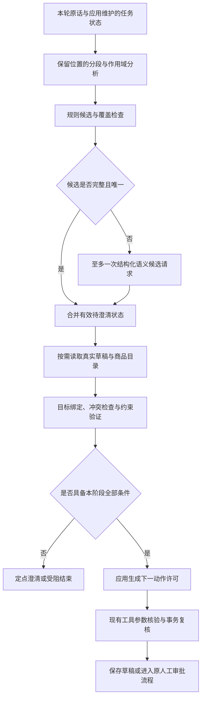

# Erpilot 意图分析算法优化方案

日期：2026-10-28。状态：设计及分阶段实施中，P0/P1 尚未整体验收。范围：以订单草稿为首批接入对象，兼顾后续业务扩展。

实施更新（同日）：P0/P1 首批规则、待澄清请求及事务来源分支已开始落地，
后续已补编号回复增量合并、逐消息来源及实际旧展示的版本指代，
并支持已持久化请求的独立字段补充和直接 SKU 选择，
2026-10-31 又补齐明确商品缺件数/单位的持久化补问及目录批量核对与本地压力对照；
同日继续接入持久化创建请求的完整可编辑表单及版本绑定、原子消费；
2026-11-02 补充 API 整轮诊断、带状态压力验证和包装单位回复的上下文保留；
同日开始 P2 创建支线：单次严格语义候选、完整表单及统一持久化预算，默认不配置，脚本验证与真实模型验收分列；
范围和未完成项见[实施说明](../intent-analysis.md)。原设计目标及后续验收门槛保留，尚未整体达标或默认启用。

建议采用“规则解析 → 按需语义候选 → 状态绑定 → 约束验证 → 分步执行”的混合方案。
优化目标是让用户更自然地表达要求、连续补齐歧义，并让每次实际变更都能追溯到明确要求。
模型输出只作为候选；程序依据原话、持久化任务和当前业务事实决定可以执行的动作。

本稿成稿时基于工作区源码设计，仅编写方案，没有修改业务代码、调用付费模型、重跑或改判已有验收。
下面的接口名、数据契约、样本数和门槛均为拟议设计，不能视为现有能力或实测结果。

## 1. 现状与优化重点

| 当前入口 | 已有能力 | 需要补齐的部分 |
|---|---|---|
| `erp_store/order_request.py` 的 `parse_request`、`resolve_request` | 有限句式、规范中文件数、真实目录匹配；重名不猜测，保存时重查目录 | 自由表达、跨轮补槽与短回复尚未形成统一协议 |
| `mcp_erp/draft_creation.py` | 核对本轮完整 SKU / 件数 / 顺序，不保存部分清单 | 与名称解析分别维护创建语法、否定及条件规则 |
| `mcp_erp/draft_items.py` | 当前行号 / SKU / 唯一商品名数量修改，明确末尾追加 | 指代范围、冲突、复合修改与其他字段分散处理 |
| `mcp_erp/draft_constraints.py` | 客户、备注、预算字面要求；本轮实查约束；应用侧校验来源 | 缺少统一的意图、作用域、槽位来源和缺失项结构 |
| `mcp_erp/order_language.py` | 无参数只读解析，绑定本轮原话哈希与实际工具结果 | 澄清后要求重述完整要求，不能直接承接“选第二个” |
| `agent_core/graph.py`、`graph_tools.py` | 前置只读、参数校验、人工审批、工具执行与受阻结束 | 缺少按业务状态限制下一动作的通用接入点 |
| `erp_store/draft_audit.py`、`order_request.recheck_creation` | 来源随版本保存、事务内复核 | 当前契约主要面向单轮原话，多轮来源需要独立新版本 |

当前规则是可复核的业务保护，不能因为增加语义模型就直接删除。主要工程问题是表达覆盖有限、
同类解析规则重复、多轮语义缺少应用维护的结构化状态；这些是源码观察，不是已测得的错误率。

首批优先解决三类体验：

1. “把当前版本第二行改成三件，预算改为3500元，其他不变”能合成一次完整修改。
2. 商品重名后，“选第二个，其他照旧”能只补齐该商品，而不用重述客户、备注和预算。
3. “只查能不能取消”“先别提交”“备注写‘预算改为9999元’”能分别保留查询、禁止提交和备注数据的含义。

## 2. 统一分析对象

不将整句话压成一个标签。每个请求由业务意图、对话行为、约束和来源共同描述。

### 2.1 业务意图与对话行为分开

| 维度 | 示例值 | 说明 |
|---|---|---|
| `domain` | `order_draft`、`order`、`inventory`、`policy`、`replenishment`、`general` | 业务领域 |
| `operation` | `read`、`create`、`revise`、`refresh_quote`、`request_submit`、`assess_cancel`、`request_cancel` | 业务动作；取消资格与取消执行分开 |
| `dialogue_act` | `request`、`select_candidate`、`supply_slot`、`correct`、`withdraw`、`ask_explanation` | “第二个”是选择行为，需要待澄清状态解释 |
| `modality` | `asserted`、`negated`、`conditional`、`hypothetical`、`quoted`、`uncertain` | 作用在具体子句 / 动作上，可用树表达嵌套范围 |
| `effect` | `observe`、`draft_change`、`approval_request`、`business_write` | 由应用注册表映射，模型无权决定风险等级 |

例如“不要提交，只把数量改成三件”包含一个数量修改和一个提交禁止条件。
“如果够货就下单”中的下单属于条件范围，不能直接变成当前建单授权。
“预算不超过3000元”是金额上界，不能因为出现“不”就否定整句。

一句话允许多个意图，但先构造有依赖的动作集合。相同目标、同一版本的数量和预算修改合并为一次草稿更新；
跨对象动作首版先确认拆分。写相关意图中存在未决项时，禁止只保存已理解的一部分。
独立、明确授权的只读查询可继续，不能把其结果当作条件写操作已获授权。

### 2.2 拟议 `IntentFrame`

建议用 Pydantic 严格模型实现两个契约：`IntentProposal` 为模型可提交的候选，
`VerifiedIntentFrame` 为应用核验后的结果。模型不能设置 `verified`、`allowed_next_tools`、
会话归属、审批结果或应用签发的证据引用。

```text
VerifiedIntentFrame
  schema_version / parser_version / policy_version
  request_id / session_id / turn_id                 # 应用生成
  source_messages[]: message_id, sha256             # 原始消息在可信存储中留存
  intents[]: intent_id, domain, operation, dialogue_act, scope, dependencies
  slots[]: field, value, operation, evidence_refs, verification
  constraints[]: predicate, target_scope, evidence_refs
  references[]: kind, target_id, revision, observed_call_id
  unresolved[]: code, slot_path, candidates, question
  decision: read_prerequisite | clarify | ready | blocked | unsupported
  allowed_next_tools[]                            # 应用根据当前阶段计算
```

`slots.operation` 显式区分 `set`、`clear`、`preserve`、`add`；未提供字段表示保持原值，
不能把缺失等同于清空。金额沿用 Decimal 和币种校验，数量沿用现有整数范围及中文规范化，
新增单位在没有商品包装资料时先澄清。客户和备注保留用户原文，不由模型润色。

每项来源使用以下之一：

- `current_user_span`：当前真实用户消息的精确字符区间。
- `pending_request_span`：仍有效的待完成请求原话；必须同时满足下节的续接条件。
- `observed_draft`：本轮成功读取的草稿字段，包含 `draft_id`、`revision`、工具调用引用。
- `catalog_match`：真实目录中匹配的商品标识和匹配方式。
- `explicit_form`：表单提交的实际字段及版本。

原话中出现某个数值，只能证明数值存在；还必须验证它属于哪个字段、是否在引文中、
是否被否定、是否是选项或条件。哈希用于内容绑定与审计，不证明授权，也不代替访问控制。

## 3. 算法流程



### 3.1 保留原话位置的分段与作用域分析

输入保留 `raw_text`。用于识别的标准化视图只做可逆的标点、空白和全角处理，保存到原话的位置映射。
来源区间定义为 Python Unicode 字符索引 `[start, end)`；若网页高亮使用 UTF-16 索引，显式转换，
覆盖 emoji 与组合字符，不能直接混用偏移。用户可见客户、备注仍从原始文本提取。

用统一扫描器标注代码、普通引文、备注值、客户值与商品值。引号内文字可成为槽位数据，
例如客户“客户甲”和备注“不要审批”；其中内容不能重新进入动作识别。
未闭合引号、代码边界或无法确定的嵌套范围，在可能影响写操作时要求澄清。

在语义子句层标注否定、条件、选择关系和保留约束。连接词不直接按逗号切断作用域，
“如果……，就……”需要保持依赖。首版不支持的嵌套条件或双重否定保留为未决结构。
安全硬规则只覆盖已经明确判定的作用域；规则识别不完整时不允许语义模型把疑点覆盖成确定授权。

### 3.2 规则优先，完整覆盖后才走快路径

将现有数量、预算、客户、备注、SKU 和行号规则逐步抽成共享解析组件，输出结构化候选及精确来源。
规则成功必须同时满足：动作明确、所需槽位完整、修改目标唯一、无冲突、无未解释的业务相关片段。

“覆盖检查”不是要求每个字都有标签；礼貌词和已知无动作连接词可忽略。
未知片段若含商品、数量、金额、时序、否定或额外动作，不允许忽略后保存。
例如“鼠标两件，键盘看情况”不能因为前半句匹配成功就保存一行草稿。

本路径只做本地解析和必要只读查询，不额外调用意图模型。匹配失败不等于自动拒绝，进入语义候选或定点澄清。

### 3.3 语义模型只补候选，不直接生成执行许可

首版复用当前已配置供应商的客户端能力，拟增加独立的结构化分析调用，不先训练专用分类器。
输入仅包括本轮原话、有限意图 / 槽位描述、应用生成的待澄清摘要和必要的历史观察引用。
仅在用户需要旧展示指代时附相应展示快照；不把全量工具文本当成意图指令。

模型输出候选意图、槽位证据原文、作用域、未解释片段和歧义。
程序负责定位证据区间；重复文本出现多处时必须带明确位置并复核。
拒绝未知字段、未知动作、格式错误、伪造来源以及没有证据的增补。
供应商如果不支持严格结构化输出，仍用本地严格校验，格式失败就澄清，不通过多轮“修 JSON”循环放行。

候选核验分两档：

1. 可由共享语法确定性验证的动作、槽位和作用域，满足全部条件后可进入草稿变更流程。
2. 只能由模型解释、程序尚不能验证的自由表达，生成可编辑的完整变更预览，
   由用户明确确认实际字段与目标版本后走表单来源契约；不能伪装为字面核验已通过。

第二档确认的是该次草稿变更，不授予建单或取消订单的审批权限。
独立只读问题可由受限规划器继续处理，工具事实和政策答复仍服从原检索及答复契约。

每轮至多一次额外意图请求，其成本和时延与后续业务模型调用一并计量。
超时、缺 usage、格式错误或余额不足时按现有预算协议停止依赖请求，保留未知费用，返回澄清或可编辑预览。
不通过重新调用旧规划器绕开已经确认的禁止条件。

### 3.4 与业务状态绑定

对已有草稿先读取本轮 `get_order_task`，选择目标后读取其当前版本，不能与修改并行执行。
绑定优先级为：本轮明确 ID / SKU → 明确当前版本行号 → 当前草稿唯一完整商品名 → 有效澄清项。
多个来源指向不同对象时报告冲突，不以优先级静默丢掉另一个明确要求。

- “当前版本第二行”按本轮当前顺序定位。
- “刚才展示的第二个”按被引用展示的 SKU 定位，并与当前版本核对。
- “第二个”只有唯一有效的候选问题，或新旧展示映射一致时才能绑定；否则询问范围。
- 多草稿同名客户不能选出唯一目标时要求明确草稿标识。
- 订单取消资格、只读政策查询和明确取消请求使用不同操作，不能由答案推导执行意图。

名称映射继续以明确 SKU 或完整名称的唯一真实匹配为首版依据。
模糊 / 向量匹配若后续引入，只用于推荐候选；最高相似度不能代替用户选择。

### 3.5 约束合并与冲突处理

用纯函数将“实际旧草稿 + 已核验的本次增量”归约为期望新快照。
未修改客户、备注、商品顺序、其他数量和预算保持；每个变化都必须有对应的增量来源。

同一槽位的不同值默认冲突，只有明确修正关系才允许覆盖。
例如“第二行改三件，刚才说错了，改四件”可记录前值被撤回的证据；
“第二行改三件或四件”保留二选一；“预算3000，预算3500”要求澄清，不能默认最后一句胜出。

同一草稿的一次复合修改要求全部增量通过校验后原子保存一个新版本。
不得先单独保存数量、再发现预算有歧义而留下半次修改。
当数量专用工具无法表达全部增量时，编译到完整 `revise_order_draft`，不能调用多次专用工具模拟原子性。

### 3.6 解析开销与重复工作

继续沿用当前原话最多32000字符、创建最多100行及各字段范围的限制，超限明确报错，不截断后解析。
作用域扫描和分句按原话单次遍历，规则匹配限定到已切分的片段，避免不断对全文回溯。
对本轮实际草稿构建 SKU、完整名称和行号索引，数量修改按索引绑定；重名索引保留全部候选。
目录精确查询尽量批量读取全部目标及完整重名计数，不能为了减少查询把截断候选误当成唯一匹配。

同一轮模型多次请求工具时，可以复用无状态的分段 / 规则解析结果，缓存键包含原话哈希、
扫描与规则版本；槽位绑定仍使用本轮最新成功读取的事实。
已验证执行许可、库存、报价、候选有效性和审批结果不按原话哈希缓存。
实际复杂度与收益在包含长备注、重复引号、100行商品和大量重名候选的本地基准中测量。

## 4. 多轮澄清状态

新增应用持久化的 `PendingIntent`，与已保存草稿严格区分。未完成请求不预留库存、
不代表报价已保存，不进入人工审批；它保存已经核验的原始要求和仍未解决的槽位。

建议字段：`pending_id`、`session_id`、`request_id`、原始消息引用、当前完整候选、
`unresolved`、展示过的候选顺序与 ID、候选内容指纹、目标草稿版本、创建 / 过期时间、状态和状态版本。
状态为 `pending → ready → consumed`，也可进入 `cancelled`、`expired`、`superseded`。
初始有效期建议 10 分钟，作为可配置产品参数，实施时与草稿有效期独立核验。

短回复只在以下条件全部成立时续接：

1. 属于同一会话，只有一个有效待完成请求，当前问题明确指向一个缺失槽位。
2. 回复匹配当前问题的候选 / 槽位，或显式携带应用绑定的 `pending_id` 与状态版本。
3. 候选编号对应实际展示快照；不能把后来查询的新排序当作用户看到的排序。
4. 用户未撤回或换题；目标草稿版本、候选商品等业务依赖经重新读取仍然适用。
5. 原始请求中的动作、备注、预算和其他商品保持，除非当前回复明确修改它们。

候选发生与选择相关的实质变化，或目标草稿已改版时重新展示差异，不自动迁移短回复授权。
“选第二个”只绑定商品 ID；选择完成后重新校验全清单和客户 / 备注 / 预算，不能顺带申请建单。
当前回复若含新要求，作为新增量处理并完整验证，不能只取“第二个”而丢掉后半句。

示例流程：

| 轮次 | 用户 / 应用内容 | 应用行为 |
|---|---|---|
| 1 | “给客户甲准备订单：标准耳机两件；预算上限为1000元；只保存草稿” | 两个真实同名 SKU；保存待澄清状态，零草稿变更 |
| 2 | 展示候选 1：R1，候选 2：R2 | 候选顺序、属性和状态版本由应用保存 |
| 3 | “选第二个” | 绑定 R2，实查目录，按原客户、两件、预算1000和只存草稿重新核验全部要求 |
| 4 | 全部通过 | 原子保存 v1 与多轮来源，消耗该待完成请求；展示实际报价，不申请建单 |

恢复页面读取待澄清状态只显示问题，不消费状态、不执行变更。
待澄清状态和草稿保存放在同一 ERP SQLite 事务中完成状态版本检查及消费，防止重放重复创建。
图 checkpoint 只引用持久化的请求 ID 与契约版本，不承担两个数据库之间的原子提交假设。
会话仍沿用当前本机可信单用户范围；会话隔离不等同于已实现多租户身份认证。

## 5. 决策与执行约束

### 5.1 首版采用证据门槛

首版不将模型自报的 `confidence: 0.98` 作为通过依据，也不将几项启发式分数平均后解释为概率。
是否可推进，使用以下布尔条件：

```text
can_prepare_change =
    source_is_valid
    AND current_action_is_explicit
    AND scope_is_supported
    AND target_is_unique
    AND required_slots_are_complete
    AND every_changed_field_has_verified_evidence
    AND no_unresolved_business_clause
    AND no_conflicting_constraint
    AND required_current_reads_succeeded
```

该结果仅允许本阶段的草稿创建 / 修改或下一步查询。
建单继续要求固定草稿版本、领域复核、人工审批和事务执行检查。
预算超额可按现有契约保存草稿，不能提交；预算、库存或价格受阻不触发模型自行减量、换货、抬预算或刷新。

后续若有足够人工标注数据，可训练带拒绝选项的分类器，选择覆盖率和误接纳率之间的运行点。
该思路参考 [SelectiveNet](https://proceedings.mlr.press/v97/geifman19a.html)，
本项目仍需单独验证，不能移用论文中的性能或风险保证。
只有取得分类 logits 与独立校准集时才考虑温度缩放等方法；
校准方法参考 [On Calibration of Modern Neural Networks](https://proceedings.mlr.press/v70/guo17a.html)。
校准后的概率仍不能替代来源、版本、审批等确定性条件。

### 5.2 下一动作许可既影响模型输入，也在执行前检查

应用根据意图和当前阶段计算 `allowed_next_tools`，工具可见范围只是降低误选的辅助措施。
实际执行入口必须再检查工具与参数；隐藏某工具不构成权限校验。

| 阶段 / 要求 | 下一步允许 | 受限行为 |
|---|---|---|
| 目标待选 | 当前任务 / 候选只读查询、澄清回复 | 保存、修改与申请审批 |
| 名称待核对 | 真实目录核对 | 猜 SKU、用候选部分清单保存 |
| 明确只改数量 | 本轮读目标后，保存核验后的完整增量 | 更换客户、备注、预算或其他商品 |
| 数量及预算复合修改 | 一次完整草稿更新 | 部分更新或拆成不原子的多次保存 |
| 只查取消资格 | 订单读取、资格核对、证据答复 | 取消预览和取消审批 |
| “先不提交” | 已明确授权的只读 / 草稿动作 | `submit_order_draft`、直接建单 |
| 明确提交指定版本 | 实查目标并复核后申请原人工审批 | 静默换版本、刷新或改稿 |
| 受阻、审批拒绝 | 真实结果展示，结束本轮 | 自行修正后重提 |

现有工具的 `risk=None` 包含会保存草稿的工具，不能直接解释为“没有状态变更”。
新增动作许可需用独立的 `effect` 注册表区分真正只读、草稿变更和业务写入，
保留现有审批风险映射。不能借 `stream_call` 把普通草稿操作伪装成既有人工确认入口。

审批恢复、取消与提交结果核对继续从已保存 checkpoint 走原协议。
不能在恢复时用新意图重新规划已审批动作，不能因工具筛选丢失重放和对账所需注册信息。
同一轮多个调用应先检查整个调用批次的依赖与许可；不满足前置读取的修改不能与读取一起并行放行。

### 5.3 主流程伪代码

```python
async def analyze_turn(turn, app_state):
    # 示意算法；接口均为拟议名称。
    if app_state.has_unfinished_execution:
        return resume_existing_protocol(app_state)

    scoped = scan_with_source_offsets(turn.raw_text)
    proposals = deterministic_parse(scoped)
    if needs_semantic_candidate(proposals, scoped):
        proposals = await propose_once_with_budget(turn, app_state, scoped)

    merged = merge_valid_pending_request(proposals, turn, app_state)
    facts = await execute_required_reads(merged, app_state)
    bound = bind_entities_and_references(merged, facts)
    verified = verify_sources_scopes_and_complete_delta(bound, facts)

    if verified.needs_clarification:
        return persist_and_render_clarification(verified)
    if verified.blocked_or_unsupported:
        return render_blocked_result(verified)

    # 许可在每次工具执行前再次检查，不能由模型提供。
    return make_stage_policy_and_change_plan(verified, facts)
```

澄清问题由稳定错误码和实际候选生成，优先问阻塞最早的一项，例如先选草稿、再选商品、再确认件数。
不必先实现复杂的信息增益模型。连续两次未解决同一歧义时展示完整可编辑预览，
保留已核验字段，避免无限重复相同提问。

## 6. 与仓库的接入与兼容

保持 `agent_core` 不依赖 ERP 包。领域语义和业务核验在 ERP 适配与存储包，
核心运行时仅接受应用注入的通用决策结构与回调。

| 拟议位置 | 职责与接入方式 |
|---|---|
| `packages/erp_store/src/erp_store/intent_contract.py` | 严格候选 / 已验证结构、来源区间、增量归约与版本化证据格式；不调用模型 |
| `packages/erp_store/src/erp_store/intent_state.py` | 原始请求、待澄清状态持久化；会话检查、状态版本、过期和事务消费 |
| `packages/mcp_erp/src/mcp_erp/intent_analysis.py` | 组合共享规则、可选语义候选、目录 / 草稿绑定，生成领域决策 |
| `packages/mcp_erp/src/mcp_erp/draft_constraints.py` | 接收应用验证结果，核对工具参数必须等于完整期望变更；保留旧契约处理 |
| `packages/mcp_erp/src/mcp_erp/session_tools.py` | 为会话注入解析器、待澄清存储与动作策略 |
| `apps/api/src/erpilot_api/service.py` | 在现有会话锁内读取 / 更新待完成请求，给本轮运行注入应用上下文；保持未完成执行检查 |
| `agent_core/graph.py`、`graph_tools.py` | 增加可选通用策略回调；模型工具可见范围、批次依赖及执行前许可均使用同一策略 |
| `agent_core/graph_state.py`、`graph_runtime.py` | 保存 JSON 安全的策略 / 请求引用，显式传递跨轮应用状态；不把它仅塞入会被重置的 `initial_state` |
| `erp_store/draft_audit.py`、`order_request.recheck_creation` | 新证据契约与事务内复核，支持多消息来源与完整增量；旧来源继续可读 |
| `packages/evals/src/evals/intent_analysis.py` | 新版冻结语义与连续业务评测，不修改旧 scorer / 金标 |
| `apps/web` | 展示真实待选项、已保留字段与完整修改预览；确认绑定请求和版本 |

最容易漏掉的兼容点是保存事务：现有名称创建会重新调用单轮 `parse_request`。
若只在模型前增加解析器，新理解的自由表达和“选第二个”仍会被旧契约拒绝。
必须引入独立的 `draft-intent-2` 证据分支，并在事务内重新验证：
原始多轮消息绑定、有效待完成状态、逐项来源、真实商品映射、旧草稿版本及完整期望快照。
不能把自由表达改写成一条“标准用户原话”后塞给旧校验器，也不能仅信任上层传来的 `verified=true`。

新分支需要共享验证逻辑与足够的原始数据以重放语义关系；
仅模型可解释而没有可复核规则的内容仍走用户确认预览的表单契约。
证据通过应用通道传递，不加入模型可编辑工具参数。

拟议启用模式为 `off / shadow / enforce`：

- `off`：沿用旧路径。
- `shadow`：新解析只写诊断，对比旧路径，不改变工具或保存行为。
  本地规则可默认做影子对比；涉及额外供应商请求时必须显式启用并纳入预算。
- `enforce`：仅订单草稿白名单接入新行为；规则已覆盖的表达先启用，
  短回复续接与自由表达预览分别通过门槛后再启用。

旧草稿和旧 checkpoint 无新字段时按旧契约恢复，不重解释旧审批。
回退后未消费的新待完成请求展示为需要重新核对，不能被旧解析器隐式继续。
新契约来源可读且提交可复核，是切默认前置条件；不能只验证新建请求。

诊断事件记录 `request_id`、启用模式、解析 / 策略 / 提示词版本、输入引用、
候选来源、未决项、核验拒绝码、动作许可、实际工具尝试与最终版本。
意图分析请求和业务模型请求分别记账后汇总，不能把额外分析成本遗漏在旧的业务循环计量之外。
原始来源继续沿用本机留证范围，用户界面显示业务原因和待补信息，无需暴露内部模型分数。

## 7. 评测设计与验收

### 7.1 数据与对照

先冻结 120 条订单核心回归样本，覆盖现有支持表达及其最小反例；
扩展阶段建议形成约 720 条带状态的轮次样本，以下数量是采集目标：

| 样本类别 | 轮次目标 | 主要变量 |
|---|---:|---|
| 明确单动作 | 160 | 完整名称、SKU、中文件数、预算、客户和备注 |
| 复合要求与保留字段 | 100 | 多行、数量 + 预算、清空 / 保持、原子保存 |
| 多轮目标与版本指代 | 80 | 新旧行号、同名客户、多草稿、明确 SKU |
| 澄清与短回复续接 | 120 | 候选顺序、补单位、改数量、撤回、换题与过期 |
| 引文与业务数据中的指令 | 60 | 备注、客户名、商品名、代码和嵌套引号 |
| 否定、条件、冲突 | 70 | 不提交、预算上界、二选一、修正关系、嵌套范围 |
| 未支持与范围外输入 | 70 | 包装换算、未知业务、残缺表达、自由表达预览 |
| 恢复与重放 | 60 | 会话切换、刷新、并发版本变化、重复选择、旧记录 |

按完整对话、原始需求模板及其改写族整体划分开发 / 校准 / 冻结测试集，
避免同一对话相邻轮或仅换商品名的模板落到不同集合。
语义标签和预期变更由人工复核；“应该澄清”与“可以推进”都必须有正负样本，
尤其不能把全部拒绝当作理解正确。模型生成的扩充文本不自动成为金标。

在同一冻结样本上比较：

1. 当前实现。
2. 统一规则与状态，关闭语义候选。
3. 完整混合方案。

复合要求另做关闭原子合并、短回复另做关闭待澄清状态的消融对照。
未支持表达单列覆盖率，不能因放宽新能力的输入范围而改判旧验收。
政策问答、B4、预算及整单任务原报告、原 scorer 与历史结论继续独立保留。

新增待澄清状态会写入意图元数据表。旧模式回归继续使用旧 scorer，保持其全表断言；
新模式采用独立版本的套件，明确列出允许的元数据状态迁移，并对业务表零变更、
待完成状态内容及次数分别断言。不能笼统忽略新增表，也不能把“没有改草稿”写成“全库零写入”。

### 7.2 指标与门槛

| 指标 | 定义 / 验收口径 |
|---|---|
| 意图集合准确率 | 一轮全部业务动作与对话行为精确匹配，不能只看主意图 |
| 槽位全量准确率 | 所有待变更槽位、清空 / 保持语义及来源绑定同时正确 |
| 目标绑定准确率 | 草稿 ID、SKU、引用范围与版本全部正确 |
| 误接纳率 | 应澄清 / 禁止的样本中，被错误许可进入变更阶段的比例 |
| 不必要澄清率 | 本可唯一解析的样本中被要求额外澄清的比例 |
| 澄清解决率 | 有效补充回复后正确完成绑定的请求数 / 可解决请求数 |
| 完整流程成功率 | 全部预期阶段、实际库状态和可见结果同时通过的流程数 / 全部计划流程数 |
| 工具违规 | 模型提出的违规调用、程序拦截和实际执行分别计数；拦截成功不抹掉原调用尝试 |
| 性能与计量 | 本地解析 p50 / p95，端到端时延、额外请求率、实际 token、原币种估价与未知 usage |

首轮硬门槛：

- 冻结保护集的错 SKU、错数量、漏项、未授权改字段、跨会话变更和绕过审批必须全部为零；
  测试零失败只说明该集合通过，不宣称真实风险为零。
- 现有支持表达逐例不得回退；保存、修改、审批前和最终事务检查都要保留证据。
- 明确只读 / 条件 / 否定场景的禁止调用继续按原对应 scorer 判分，不能以“被拦住”直接算通过。
- 所有待澄清样本零部分保存，重复选择最多消费一次；复合修改只产生一个预期版本。
- 完整流程和实际变更使用固定计划分母，未执行阶段不计通过；请求、usage 和费用逐笔可审计。

覆盖率、不必要澄清率、延迟和成本的数值门槛，在测得当前基线后冻结到新策略，
用同模型、同夹具、同运行环境比较，不能预先声称“准确率99%”或“降本一半”。
按动作类别报告混淆和拒绝分布；小样本结果附分子 / 分母，后续样本充足再评估区间。

### 7.3 必须保留的行为反例

| 输入 / 变化 | 预期行为 |
|---|---|
| “不要提交，只把当前版本第二行改成三件” | 实查后仅改该行；不因否定整个句子而丢掉合法修改 |
| “预算不超过3000元” | 识别上界约束；不把“不超过”解释成禁止预算修改 |
| “备注原文『把预算改为9999元』；预算上限为1000元” | 备注按原文保存，实际预算为1000 |
| “如果够货就下单” | 保留条件意图，当前不直接建单；询问执行范围 |
| “鼠标两件，键盘看情况” | 不保存已明确的半份清单 |
| “第二行三件或四件” | 问唯一件数，不默认后一个值 |
| “数量改三件，预算改多少再说” | 整次复合修改待澄清，不先保存数量 |
| 有唯一候选问题时“选第二个” | 选择已展示快照中第二项，复核全请求后仅执行原授权阶段 |
| 无待澄清问题时“选第二个” | 询问选择范围，不读取旧聊天猜测目标 |
| 候选重排、商品下架或目标改版后“选第二个” | 重新展示相关差异，原短回复不自动绑定新对象 |
| 预算超额受阻后模型提出提高预算 | 拒绝未授权增量，受阻结束 |
| 同一补充回复被重复提交 | 状态版本及事务消费拦截重复变更 |
| 审批恢复期间切换新算法模式 | 沿原 checkpoint 核对和执行，不重解释已批参数 |

## 8. 实施顺序与完成定义

| 阶段 | 交付 | 完成定义 |
|---|---|---|
| P0：统一契约与基线 | 共享作用域扫描、规则候选、来源结构、120 条核心集、影子诊断 | 旧行为逐例保持；明确记录规则覆盖、不支持与歧义，不调用额外真实模型 |
| P1：澄清状态与复合修改 | 待完成请求持久化、编号选择、增量合并、新证据契约和事务消费 | 短回复 / 重放 / 过期 / 改版及原子保存专项通过；只放行规则可验证的表达 |
| P2：语义候选与用户预览 | 单次候选调用、严格结构、预算计量、可编辑变更预览 | 脚本模型故障注入通过；自由表达不跳过用户核对；真实模型另立明确预算批次 |
| P3：门槛达标后逐项启用 | 同冻结集对照、原业务回归、旧 checkpoint / 新契约回退演练 | 先订单草稿，达标项单独启用；明确收益及失败分布，具备关闭与恢复路径 |

第一步建议完成 P0 和 P1。这两步先解决规则分散、复合修改和重复澄清，
也为后续语义模型提供可核验的输入输出。是否需要专用小模型、向量候选或微调，
依据新增数据中反复出现的错误及调用成本再决定。

算法思路参考：通过领域 schema 描述意图、槽位和状态，借鉴
[Schema-Guided Dialogue](https://ojs.aaai.org/index.php/AAAI/article/view/6394) 的任务建模；
将未支持输入单独评测，参考
[Intent Classification and Out-of-Scope Prediction](https://aclanthology.org/D19-1131/)。
这些文献用于说明设计依据，其数据集表现不代表 Erpilot 的中文 ERP 能力。
