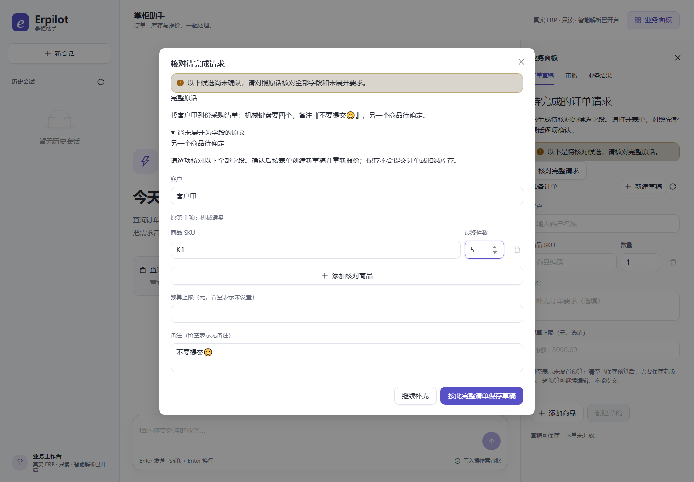

# 默认语义解析：使用、降级与验证

2026-11-04 起，真实模型 API 正式入口默认 enforce，并自动接入创建/修改语义候选。
`python -m erpilot_api`、兼容的 `erpilot_api.main:app`、`compose.live.yaml` 共用启动策略。
一键离线演示和基础 Compose 继续使用脚本模型，免密钥、免付费调用。

界面专项截图使用替身 API；真实模型结果以本轮 HTTP 验收记录为准。

## 使用

创建：输入“帮客户甲列份采购清单：青瓷茶具要两个，宣纸礼盒要三个；预算500元；备注原文『分箱发货』”。
规则能完整识别时走原路径；未完整识别、且原话没有否定/条件/引文限制时，最多调用一次模型提出候选。
预览包含完整原话、未展开片段、客户、商品、件数、预算和备注，逐项核对后点击“按此完整清单保存草稿”。
语义候选不保存业务草稿、不创建订单、不扣库存；确认完整表单才保存草稿。

修改：先选定草稿，在“按原话修改草稿”输入“调整宣纸礼盒到四个，备注改为『加急』”，
生成绑定具体草稿及版本的完整预览。未提字段继承基准，确认前原版本不变。
支持已有商品的明确总件数及客户/备注/预算；新增/删除商品、包装换算或含糊指代仍需完整表单。

保存后仍要核对指定版本、另行批准，事务复核库存、价格、预算和幂等令牌后才建单。
operator 可整理自己的草稿；只有 approver 且开启写工具后才能批准自己的任务。

## 配置

| 配置 | 真实 API 默认值 | 含义 |
|---|---|---|
| `ERPILOT_INTENT_MODE` | `enforce` | 规则、持久待完成请求、来源约束 |
| `ERPILOT_SEMANTIC` | `1` | 允许候选；`0` 停止新增候选调用 |
| `ERPILOT_SEMANTIC_TIMEOUT` | `60` | 候选总秒数；仅解析工具外层时限增加5秒，其他工具仍为30秒 |
| `ERPILOT_SEMANTIC_BUDGET` | `1.00` | 当前端点原币种的候选估算额度，**不是整个聊天的费用上限** |
| `ERPILOT_SEMANTIC_MAX_REQUESTS` | `200` | 同一预算累计候选请求上限 |
| `ERPILOT_SEMANTIC_BUDGET_ID` | `default-semantic-v1` | 当前 ERP 库共享持久预算，跨会话/账号累计，重启不清零 |
| `ERPILOT_WRITES` | `0` | 写工具另行开启，仍需审批 |

只有“模型 + 端点”匹配已登记价目才能自动估价。新端点需按供应商价目配置
`ERPILOT_SEMANTIC_CURRENCY`、`ERPILOT_SEMANTIC_INPUT_PER_M`、`ERPILOT_SEMANTIC_OUTPUT_PER_M`
（每百万 token，原币种）。未配置时 `/api/runtime` 明确说明缺价目，页面显示“使用基础解析”，
普通对话和手动草稿仍可用；不编造价目，也不拿官方价格代表中转端点。

候选费用只进入候选账本，普通聊天沿原运行时独立执行，额度用尽不会锁住整个聊天。
候选 SDK 零自动重试，失败走澄清/表单；缺 usage 视为可能收费，停止该预算后续候选。
网络恢复后普通聊天可直接重试；恢复已熔断的候选预算前应核对供应商费用，再显式分配新的
预算标识与额度，保留旧账本。不要删库或覆盖既有预算配置来清零。
额度采用请求前检查、响应后估价，最后一笔可能超出剩余额度，不是供应商账单硬限额。

## 标签与启用依据

原120条工程用例及 SHA-256 保持不变。用户已委托 AI 项目负责人完成逐条审核，
**120/120已审核，无需用户继续复核**；6条补充支持范围说明，判定/字段改动0条。
[完整审核表](../reports/review/20261104-intent-label-audit/review.md) ·
[审核后规则回归](../reports/acceptance/20261104-intent-label-review-regression.json)。
审核主体记录为AI，不冒称真人金标；规则回归不代表LLM准确率。[审核依据与核验](label-review.md)。

按用户明确要求，以来源/目录校验、完整表单、版本绑定、独立审批、默认入口正反例、
实际模型 HTTP 验收和失败降级作为启用依据。原人工复核待办已由委托AI审核收口，
今后可另做真人外部验证。旧日期报告中的 off、待审和失败判定保留其历史含义。

[本轮验收](../reports/acceptance/2026-11-04-semantic-default.md) ·
[决策](adr/0013-default-semantic-proposals.md) · [项目状态](project-status.md)
