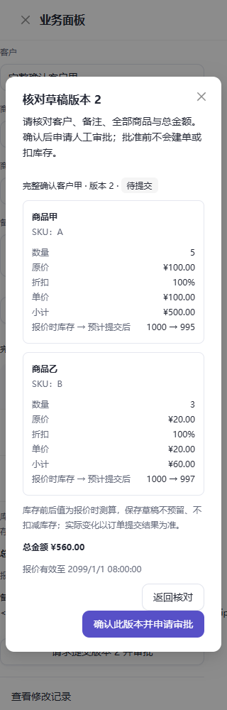
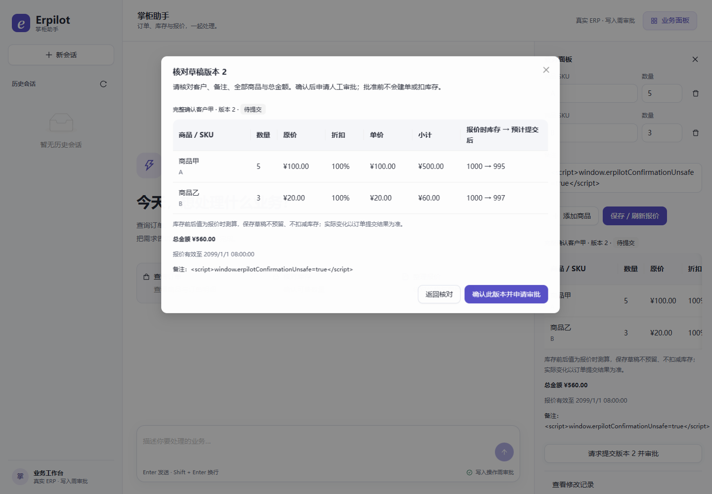

# 指定版本核对与直接申请审批验收

日期：2026-10-21。实现与边界见[功能契约](../../docs/draft-confirmation.md)。本批将人工明确确认变成可核对的页面动作，随后仍进入独立 HITL 审批与正式业务复核。

## 本批结果

| 验证 | 结果 |
|---|---|
| Python 全仓 | **1166 passed / 21 skipped**；1187 项，0 failure / error，135.306 秒；[JUnit](20261021-draft-confirmation-tests.xml) |
| 新增确认 API / 运行时专项 | 12 项，包含在全仓结果中；模型工厂一旦初始化即抛错，全部通过 |
| 前端协议与状态测试 | **91 passed**，新增 2 项；专用请求只发送版本，冲突不重试，非法版本不发请求 |
| 浏览器 UI | **29 passed**，最终版本 27.3 秒；新增 320 / 1440px 核对及版本冲突共 3 项 |
| 本地正式 API 浏览器演示 | **3 passed**；政策与补货页面两种宽度、草稿修改 / 刷新恢复 / 拒绝后直接确认批准 |
| 构建与静态检查 | TypeScript / Vite、Ruff、差异空白检查通过；保留既有前端单包超过 500 kB 的提示 |

API 专项使用临时 SQLite、正式会话工具 / FastMCP / LangGraph 和受控审批。2 项检查 HTTP 申请后批准 / 拒绝；6 项检查外部会话、旧版本、过期、只读、布尔版本及伪造批准字段；1 项完整检查旧审批失效 → 新版本确认 → 价格变化失效 → 表单刷新 → 再确认批准；2 项重建宿主恢复审批（包含同幂等键已提交夹具）；1 项拒绝未明确支持的直接工具。

批准前比较 ERP 全表快照；成功后核对恰好一单和准确库存。版本 / 报价变化用例保留旧快照、客户 / 备注来源，最后生成版本 3、金额 ¥1060 的订单，A 库存由 1000 到 995。重复旧决定或重复提交已完成草稿被拒绝。申请和恢复不初始化模型客户端，成功答复使用实际订单事实。

UI 用例使用受控 HTTP 响应检查交互和请求内容；本地正式服务演示经过真实 API、审批、MCP 和临时业务库，模型仍为离线脚本。二者分列，不计为真实模型成功率。最终手机截图已人工查看，商品逐项显示，金额无需横向滚动，备注和更多内容可在窗口内纵向查看。

## 修复与复核记录

首轮全仓回归发现延迟模型代理改变了演示清理所依赖的客户端层级，导致 1 个失败及 3 个清理错误。已保留宿主原有真实客户端引用，将延迟代理仅用于运行时；完整重跑后 0 failure / error。该修复不初始化尚未使用的模型客户端。

浏览器首轮 29 项和正式服务 3 项通过后，根据截图补齐手机逐项报价；最终 UI 29 项及生产构建再次通过。正式服务 3 项验证的是相同审批行为，其执行早于最终手机布局调整；没有将其写成再次执行。测试进程退出时，清理了本批启动的辅助服务。

21 项跳过仍为现有需独立 PostgreSQL 等环境的集成矩阵。本批恢复检查共享同一内存 saver，未新增真实进程硬退出验收。源码及测试证据哈希见[清单](20261021-draft-confirmation-evidence.json)；这是当前工作区文件指纹，不是 Git 提交或部署证明。

## 历史结论与费用

本批 **0 次新增付费模型请求**。确认入口由用户页面动作直接选择受审批工具，普通聊天仍依赖模型。

[上一批真实验收](2026-10-21-whole-order-acceptance.md)原三流程 GLM 2/3、明确接受外部变更的独立流程 11/11 阶段及 GLM 历史 2/2 全部保留，不能改写或拼成原流程 3/3。DeepSeek 限流缺 usage 后的冻结与原未知费用不变，两模型共同门槛和跨批次重复验证仍未完成。

本次完成的是网页确认提交这一明确入口的可靠性改进；取消、库存调整的直接确认入口及更广业务约束未在本批扩展。
