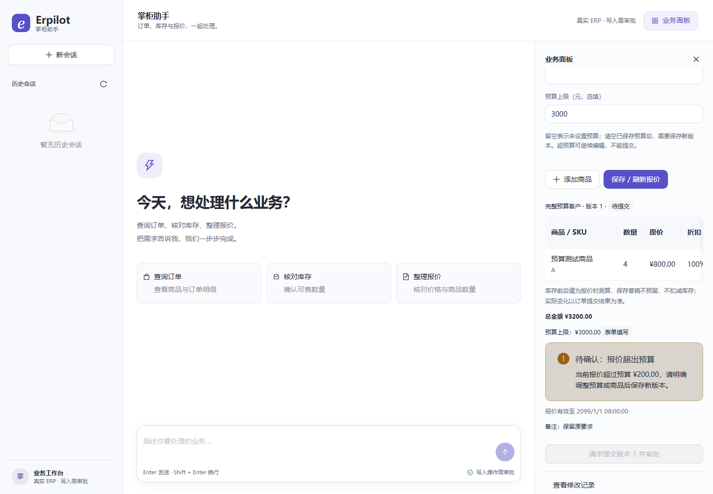
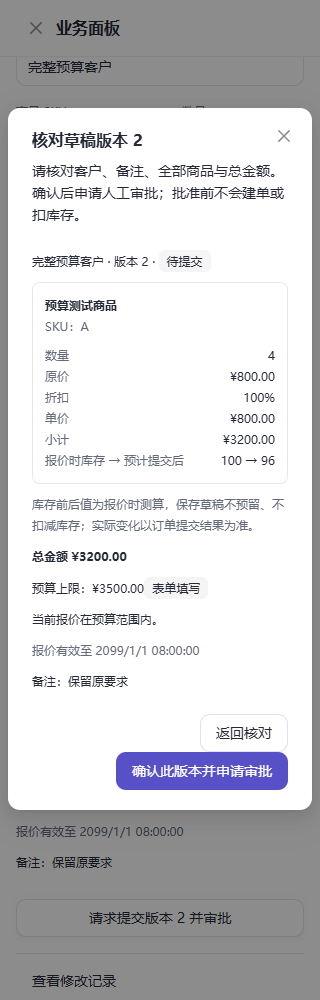

# 预算上限与待确认事项验收

日期：2026-10-21。按用户同意的下一阶段方案完成预算约束，契约见[功能说明](../../docs/order-budget.md)。

## 交付结果

预算随草稿版本持久保存，修改数量和刷新报价保留预算与原始来源。超额可保存草稿，面板显示实际差额和待确认事项；网页、审批前工具校验及建单事务均拦截超额提交。用户明确变更预算或商品后保存新版本，重新核对和审批。历史可查看预算变更，旧审批不授权新版本。

对话采用有限的明确人民币预算分句，备注中的指令、旧消息和模型自行提出的预算不能授权更改。未支持的预算表达不会静默丢失。HTTP 省略预算表示保留，显式 `null` 取消；MCP 取消使用 `clear_budget=true`。没有新增数据库表或列。

## 验证结果

| 检查 | 结果 |
|---|---|
| Python 全仓 | **1206 passed / 21 skipped**，1227 项、0 failure / error、136.686 秒；[最终 JUnit](20261021-order-budget-tests.xml) |
| 预算专项增量 | **40 项**包含在全仓中：领域 14、MCP / 运行时 19、API 7 |
| 前端协议与组件 | **93 passed**，含新增预算值、来源和审批约束 2 项 |
| 浏览器 UI | **31 passed**，含新增 320 / 1440px 预算、刷新、超额锁定和明确修改 2 项；截图等待弹窗动画完成后重新检查两项通过 |
| 正式本地服务演示 | **4 passed**，含新增表单超额 → 刷新恢复 → 明确提高预算 → 新版本核对 → 批准建单 |
| 静态检查与生产构建 | Ruff、TypeScript / Vite、差异空白检查通过；既有单包超过 500 kB 提示保留 |

领域完整用例从 ¥3000 上限、¥3000 报价开始，新增商品使版本 2 报价 ¥3200；超额 ¥200，提交失败，订单数和库存不变。明确提高预算至 ¥3500 后得到版本 3，旧版本提交仍被拒绝；新版本批准生成恰好一单、金额 ¥3200，A 库存 100 → 97、B 100 → 99，同幂等键重放不重复扣减。旧预算快照及客户 / 备注来源保留。

API 用例将模型工厂设为一经初始化即报错，证明超额专用确认在审批前被拒绝、明确改预算后原审批执行链仍能成功；另验证预算改变后，重建宿主恢复的旧批准返回 `draft_changed`。MCP 用例验证真实工具来源、明确提高 / 取消、参数遗漏与伪造、引号备注、旧用户消息、冲突表达及未知表达。模型提交超额用例只允许一次脚本模型请求，证明被拒绝后程序终止、不再请求模型。

浏览器 UI 使用受控接口响应验证交互；正式本地服务演示经过实际 FastAPI、LangGraph、MCP 和临时业务库，模型为离线脚本。新增演示最终正确创建 ¥980 订单，预算从 ¥500 明确调整到 ¥1000。两类证据分列，不计为供应商真实模型成功率。

## 复核与范围

首轮全仓 1223 项有一项旧测试仍期望跨会话草稿先进入审批，再拒绝实际提交。新审批前读取已在创建审批前拒绝该目标；测试更新为要求无审批、无私有客户泄露、订单及库存不变，没有放宽安全要求。首轮记录见[初次 JUnit](20261021-order-budget-initial-tests.xml)，新增四个未支持预算表达检查后完整重跑通过。

21 项跳过为显式隔离 PostgreSQL 配置所需的既有集成矩阵。恢复检查共享 `InMemorySaver`，不等同于真实进程硬退出后的持久恢复。本批维持本机可信单用户、单 API 进程范围。

本批 **0 次付费模型 / 嵌入请求**，没有重试或重开已跳过的 DeepSeek 批次，也没有部署。预算功能尚未做供应商真实模型专项；[预算加入前的 GLM 3/3](2026-10-21-cross-model-order-acceptance.md)与本批工程结果分列。金额只有人民币，待确认事项目前仅针对预算超额，未扩展通用问题管理、交期或替代商品规则。

当前源码、测试与截图哈希见[证据清单](20261021-order-budget-evidence.json)，用于复核本工作区交付，不是 Git 提交或部署证明。
