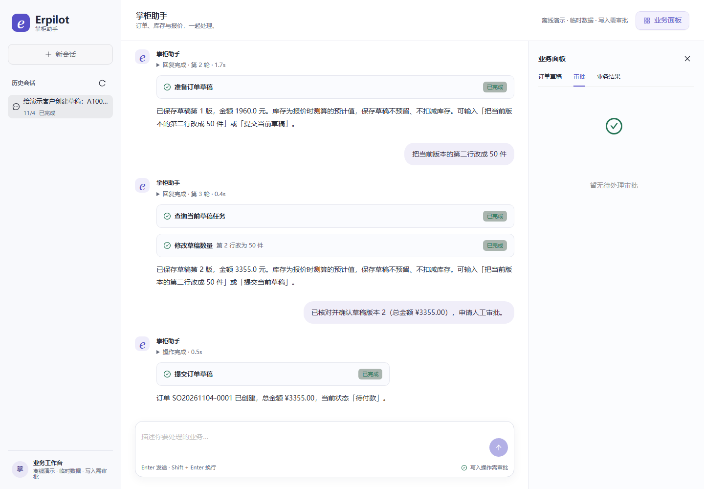
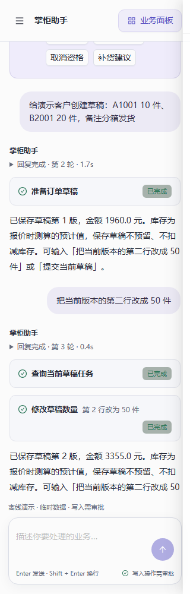

# 2026-11-04 最终打磨与展示验收

结论：本轮发现的问题已闭环，达到本地求职作品的演示与复现标准。保持原有业务范围和架构，
没有新增业务功能。本轮供应商模型及嵌入调用为 0；既有真实模型批次保持各自的结果和边界。

## 打磨清单、改法与影响面

| 类别 / 优先级 | 体检问题 | 修复与理由 | 验证 |
|---|---|---|---|
| 硬伤 P1 | 排除的真实评测仍在收集时加载 `.env`，部分假模型入口测试也读取本机配置，导致离线结果依赖机器环境 | 真实配置延迟到实际选中的 fixture 初始化；模块结束恢复环境；入口测试隔离配置和远程 sink，避免改变其他测试模式 | 收集回归、四个真实套件的离线 setup / 预算初始化探针、全仓通过 |
| 硬伤 P1 | 空白或无限长聊天可进入模型；数量和拒绝原因缺少对应上限 | 空白消息在 HTTP 前校验，聊天最多32000字符、会话ID最多128、拒绝原因最多2000、手动数量最多999999999；页面同步边界 | HTTP拒绝时不进入模型；协议单测、浏览器输入边界 |
| 硬伤 P1 | 深度嵌套 JSON 可让认证请求解析抛出 RecursionError | 异常请求返回结构化422，维持既有请求大小限制 | 20000层嵌套请求与原认证测试 |
| 硬伤 P1 | 录屏脚本直接等待批准，漏掉指定版本核对确认 | 先确认弹窗中的版本，再等独立审批；字幕同步当前边界，避免录屏卡死和过时结论 | 新录屏完整跑通11章节，约153秒 |
| 硬伤 P1 | 锁定依赖存在公开安全告警 | 更新兼容补丁；FastMCP4.0到4.1，保留接口；KaTeX覆盖上游旧约束，单独验证其真实插件 | Python/npm最终审计均0已知漏洞；实际MCP、恢复、浏览器回归 |
| 体验 P2 | 草稿加载中仍能填写或切换，返回数据可能覆盖正在编辑的内容 | 加载期间锁定编辑、新建、选择和保存，保留明确加载状态 | 浏览器等待返回后才能填写 |
| 体验 P2 | 重复SKU、超大数量及超长表单需提交后才发现 | 对齐现有客户64、SKU32、备注255、100项上限；提示合并重复商品，保留服务端hint | 前端协议和工作台回归 |
| 体验 P2 | 新匿名会话尚未持久化，页面首次恢复产生不必要的404 | 只有显式的新本地会话读取可返回204空态并禁止缓存；旧会话、账号归属和数据库错误仍按原规则失败 | 缺失/已有/503/跨账号测试，真实浏览器零错误和告警 |
| 体验 P2 | 图标参与按钮可访问名称；无模型的直接提交显示“第0轮” | 明确“新建草稿”“添加商品”的可访问名称；直接操作显示“操作完成” | 键盘/表单浏览器回归，干净源码实际建单 |
| 工程 P2 | 单块前端资源过大，粗分包出现空块或循环 | 按实际依赖模块分组，不提高告警阈值；单块最大约361KB | Windows与容器构建无大块、循环或空块告警，生产页面运行通过 |
| 工程 P2 | 嵌入配置repr可能打印密钥；环境文件变体可误入Git | 与LLM配置一致隐藏密钥repr；忽略`.env.*`并保留示例 | 配置测试、文件排除规则 |
| 工程 P2 | 源码包漏收报告图片，解压后7处截图失效 | 仅扩展文档/报告图片白名单，保留数据库、密钥、trace排除；交付时可显式选择新录屏目录 | 快照/交付专项17项、嵌套清单校验、干净副本复现 |
| 文档 P2 | 演示和投递材料仍将10-28中断批次写成最新结论，旧恢复文章未标历史，trace链接失效 | 当前入口同步11-04独立验收；标记历史范围，保留旧失败；原trace改为历史路径，链接现存报告；同步Langfuse与录屏命令 | README/docs本地链接全部有效 |

补丁背景与修复版本已核对维护方公告：[FastMCP](https://github.com/PrefectHQ/fastmcp/security/advisories/GHSA-7xgj-8392-5q4r)、
[PostgreSQL checkpoint](https://github.com/langchain-ai/langgraph/security/advisories/GHSA-6hmw-9432-67qq)、
[DOMPurify](https://github.com/cure53/DOMPurify/security/advisories/GHSA-cg2g-xh64-v4q7)、
[Vite / launch-editor](https://github.com/vitejs/launch-editor/security/advisories/GHSA-587h-7wmj-h5pm)、
[KaTeX](https://github.com/KaTeX/KaTeX/security/advisories/GHSA-238p-pmpm-9mq7)。
实际使用版本以锁文件和本轮安装后的审计结果为准，不将告警存在等同于本应用已被利用。

## 最终验证

统一验收目录：`artifacts/verification/20261104T094039Z-8045781a/`。
执行 `python scripts/quickstart.py verify --skip-install --browser`，显式接入本轮独立 PostgreSQL17
实例；浏览器使用安装版本匹配的 Chromium。最终统一流程退出码0。

| 验证 | 本轮结果 | 证据 |
|---|---|---|
| Python静态检查 / 依赖兼容性 | 通过 | [统一记录](20261104-finishing-verification.json) |
| Python全仓离线与PostgreSQL恢复 | **1861 passed、0 skipped**；47项付费eval排除 | [JUnit](20261104-finishing-python.xml) |
| 前端协议、渲染与依赖兼容 | **116/116** | [前端日志](20261104-finishing-frontend.txt) |
| 工作台浏览器 | **60 passed、2 skipped** | [浏览器日志](20261104-finishing-ui.txt) |
| 正式离线API浏览器 | **5/5**，正常流程控制台错误/告警断言全部通过 | [正式API日志](20261104-finishing-demo.txt) |
| 带账号容器浏览器 | **3/3**，含320/1440px、归属隔离、容器重建后同一版本审批和防重放 | [容器日志](20261104-finishing-deployment.txt) |
| 临时ERP业务场景 | **11/11**，实际API/MCP/事务，无真实模型 | [统一记录](20261104-finishing-verification.json) |
| 依赖审计 | **Python、npm均0项已知漏洞**，截至本轮查询；工作区源码不冒充PyPI同名项目审计 | [依赖结果](20261104-finishing-dependencies.json) |
| 源码副本复现 | 无`.env`、无已安装依赖，含空格路径，从锁定安装到构建和正式API建单通过 | [复现记录](20261104-finishing-reproduction.json) |
| 录屏 | 新字幕视频11章节、约153秒，无付费调用；历史录屏不覆盖 | [章节记录](20261104-finishing-chapters.json) |

工作台的两个跳过项依赖独立 `ERPILOT_PREVIEW_TEST_API` 实验服务，非本轮离线范围；
没有将跳过算作通过。正式API的五个场景使用实际服务和临时ERP；工作台其他场景用测试API，
两类结果分别列示。认证的主动越权/错误请求保留原401/403/404语义。

本轮初次全仓运行暴露配置污染（147失败）；移除收集副作用后，入口测试仍有同类污染
（143失败），随后逐入口隔离。中间浏览器运行暴露两个新增断言相关的可访问名称问题，
已修正实际按钮；干净副本探针另纠正了“缩窄窗口时抽屉已经打开”的测试假设。
早期失败原始记录保留在本机 `artifacts/verification/` 和 `artifacts/finishing/initial-*`，
最终结果来自上述独立完整运行，不回写前批报告。

## 可展示与复现

```sh
python scripts/quickstart.py
```

准备Python3.12+、uv、Node.js22+及npm，首次安装需要网络。演示无密钥，经过正式API、
LangGraph、MCP和临时ERP；自由表达的真实模型能力查看原独立报告。
[三分钟路径](../../docs/demo-guide.md) · [架构与追问](../../docs/interview-cases.md) ·
[源码与视频交付](../../docs/portfolio-overview.md)。

源码包：`artifacts/erpilot-finished-20261104.zip`。
带本轮视频的交付包：`artifacts/erpilot-delivery-finished-20261104.zip`。
它们是本机构建产物，不随Git分发；可按作品入口重建，并验证逐文件及内外层SHA-256清单。





## 完成度自评与边界

| 标准 | 自评 | 剩余项 |
|---|---|---|
| 细节无硬伤 | 达标：本轮已发现问题闭环，全量回归无失败，正常离线业务浏览器零错误/告警 | 无待修阻断项；不据有限测试保证所有未来输入或上游行为 |
| 体验顺滑 | 达标：空/加载/错误/超长输入、明确版本审批、断线与刷新、窄屏均有验证 | 两个专用实验服务用例未配置，单列跳过 |
| 工程规整 | 达标：锁文件、依赖修复、配置与源码说明同步，交付资源完整 | 默认安装范围以外的可选SDK不在本轮依赖审计范围 |
| 可展示 | 达标：一键演示、干净副本验证、新字幕视频、面试路径及可校验交付 | 真实模型沿用独立历史批次，本轮未新增付费观察 |

共享门店、单API进程、临时演示重启清空、真实模型语义边界继续明确保留，不新增多租户或集群能力。
最终代码差异复核见[复核记录](../review/20261104-finishing.md)。
